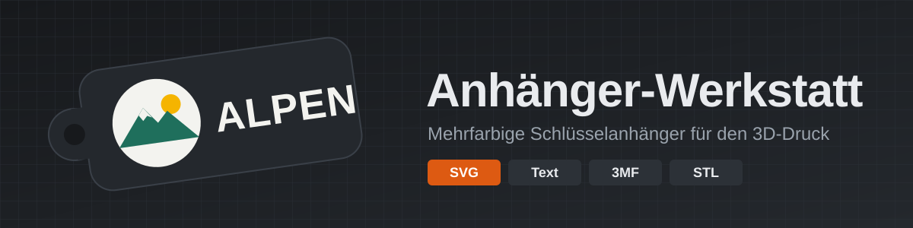
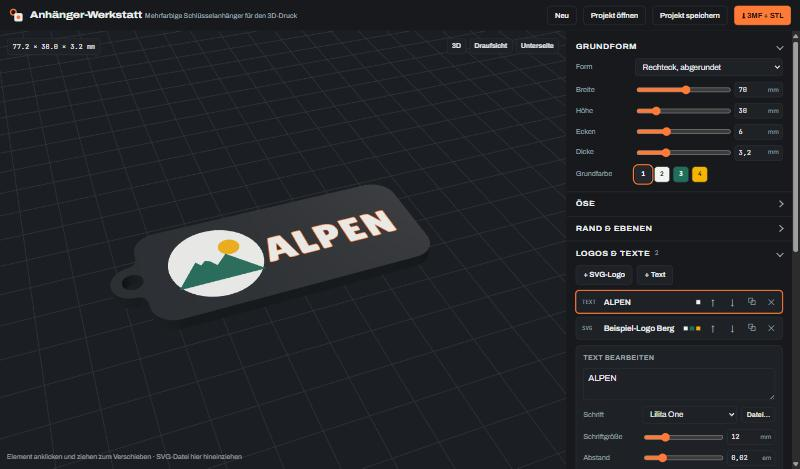

  

  <b>Mehrfarbige Schlüsselanhänger für den 3D-Druck gestalten – mit eigenen SVG-Logos und Text, direkt im Browser.</b> 
  Keine Installation, kein Konto: Logo reinziehen, anpassen, 3MF herunterladen und im Slicer drucken.

  <a href="https://barry2040.github.io/anhaenger-werkstatt/"><b>▶ App öffnen: barry2040.github.io/anhaenger-werkstatt</b></a>

> [!WARNING]
> **Vibe-coded:** Dieses Projekt ist mit KI-Unterstützung (Claude) im „Vibe Coding“ entstanden – also im Gespräch,
> Schritt für Schritt, ohne klassische Code-Reviews. Es kann daher **Fehler enthalten**.
> Geprüft wurde, dass die exportierten Körper geschlossen (wasserdicht) sind. Der Import der 3MF in einen Slicer
> ist noch **nicht getestet**. Nutzung auf eigene Gefahr – Fehler und Verbesserungen gerne als
> [Issue](https://github.com/Barry2040/anhaenger-werkstatt/issues) melden.

  

---

## ✨ Funktionen

| | |
|---|---|
| 🖼️ **SVG-Logos** | Per Knopf, Drag & Drop in die 3D-Ansicht oder Strg+V aus der Zwischenablage. Füllungen, Konturen (Strichstärke), `evenodd` und überlappende Formen werden sauber aufgelöst |
| 📐 **Automatisch einpassen** | Das Logo wird beim Import so groß wie möglich in die Form gesetzt – mit Randabstand, Rücksicht auf Loch und Rand. Liegt schon Text drauf, kommt das Logo links daneben. Jederzeit per „⤢ In Form einpassen“ wiederholbar |
| 🎨 **Automatisch anmalen** | Jede Logo-Farbe bekommt einen Filament-Slot: passende Slots werden wiederverwendet, sonst entsteht ein neuer in genau dieser Farbe. Ähnliche Töne (Verläufe, Kantenglättung) werden auf höchstens 8 Farben zusammengefasst |
| 🧽 **Hintergrund weg** | Ein Hintergrund, der das ganze Logo-Rechteck füllt, wird erkannt und weggelassen |
| 👁️ **Kontrast-Schutz** | Würde eine Logo-Farbe am Rand in der Grundfarbe verschwinden (schwarzes Logo auf schwarzem Anhänger), bekommt sie automatisch die kontrastreichste Farbe |
| ⭐ **Symbole** | 12 eingebaute Motive zum Anklicken: Herz, Stern, Pfote, Haus, Blitz, Note, Krone, Smiley, Klee, Sonne, Mond, Berg – werden wie ein SVG eingepasst und eingefärbt |
| 🔳 **QR-Code** | Link, Telefonnummer oder Instagram als QR-Code, Punkte und Hintergrund in eigenen Farben; warnt, wenn die Punkte für eine sichere Lesbarkeit zu klein werden |
| 🔄 **Rückseite** | Text, Logo oder QR-Code bündig in die Unterseite einlegen (z. B. Name oder Telefonnummer) – automatisch gespiegelt, damit es von hinten richtig lesbar ist |
| 👪 **Namens-Serie** | Eine Liste Namen eintragen und mit einem Klick für jeden Namen eine eigene 3MF bekommen – für Geschenke, Vereine oder Schulklassen |
| 🎬 **Vorschau** | Anhänger langsam drehen lassen und die Ansicht als PNG speichern |
| ↶ **Rückgängig** | Rückgängig und Wiederholen mit Knopf oder Strg+Z / Strg+Y |
| 🔤 **Text** | 12 Schriften (Google Fonts) oder eigene Schriftdatei (TTF/OTF/WOFF), mehrzeilig, Zeichenabstand |
| 🧱 **Bündig, erhaben, vertieft** | Pro Logo/Text: **Bündig** eingelegt (am saubersten mit AMS/MMU), **Erhaben** mit eigener Höhe oder **Vertieft** mit eigener Tiefe – wahlweise mit Boden in Logo-Farbe oder nur ausgeschnitten (graviert, einfarbig) |
| 🔷 **Grundformen** | Rechteck abgerundet, Pille, Kreis, Oval, Sechseck, Wappen, Herz oder **Kontur um das Motiv** (mit Abstand, Löcher füllen) |
| 🔑 **Öse** | Lasche links/oben/rechts/Ecke oder Loch innen – Durchmesser, Wandstärke und Versatz einstellbar, Übergang wird verrundet |
| 🖍️ **Rand & Kontur** | Erhabener Rand um den Anhänger und eine Kontur in eigener Farbe um jedes Logo oder jeden Text |
| 🖱️ **Direkt verschieben** | Elemente in der 3D-Ansicht anklicken und ziehen; Größe, Drehung, Spiegeln und „Verstärkung“ für zu feine Linien |
| ⚠️ **Druckbarkeits-Check** | Warnt bei Details unter ca. 0,4 mm (Düse), bei Elementen, die über den Rand ragen, und bei mehr als 4 Farben (ein AMS) |
| 🧵 **Filament-Slots** | Bis zu 16 Farben; die Nummer ist der Slot im Slicer bzw. AMS-Platz |
| 📦 **Export** | ZIP mit **3MF** (ein Objekt, Teile schon den Filament-Slots zugeordnet) + **eine STL pro Farbe** + Anleitung |
| 💾 **Projekte** | Wird automatisch im Browser gemerkt; als `.json` speichern und wieder öffnen |
| 🌗 **Hell/Dunkel** | Folgt der Systemeinstellung |

## 🚀 So geht's

1. [App öffnen](https://barry2040.github.io/anhaenger-werkstatt/) – ein Beispiel-Anhänger ist schon geladen („Neu“ leert ihn).
2. **Grundform** wählen und Größe/Dicke einstellen.
3. **+ SVG-Logo** – das Logo wird eingepasst und eingefärbt. Unter „Farben im Logo → Filament“ kannst du jede Farbe einem anderen Slot geben oder mit ∅ weglassen.
4. Optional **+ Text**, Öse, Rand oder Kontur anpassen.
5. Unter **Filamentfarben** die Slots so einstellen, wie deine Spulen im AMS liegen.
6. **⤓ 3MF + STL** – ZIP herunterladen.

## 🖨️ Im Slicer

| Slicer | Vorgehen |
|---|---|
| Bambu Studio / OrcaSlicer / PrusaSlicer | `.3mf` öffnen – die Teile sollten schon den Filamenten 1…N zugeordnet sein |
| Falls die 3MF nicht farbig ankommt | Alle Dateien aus `STL_einzeln/` **gleichzeitig** importieren → „Als ein Objekt mit mehreren Teilen laden?“ → **Ja**, dann jedem Teil sein Filament geben |
| Ohne AMS | Sind nur **erhabene** Elemente in **einer** Farbe drauf, reicht ein Filamentwechsel (Pause) bei der angezeigten Höhe Z |

**Tipps:** 0,2 mm Schichthöhe, Relief-Höhe und Einlege-Tiefe als Vielfache davon (Standard: 1,0 mm / 0,6 mm). Mit der Oberseite nach oben drucken.

## 🗂️ Aufbau

| Pfad | Inhalt |
|---|---|
| `anhaenger-werkstatt/anhaenger-werkstatt.html` | Die komplette App in einer Datei |
| `anhaenger-werkstatt/icon.svg` | App-Symbol |
| `.github/workflows/pages.yml` | Veröffentlicht die App bei jedem Push auf `main` über GitHub Pages |
| `netlify.toml` | Alternative: Veröffentlichung über Netlify |
| `docs/` | Banner und Screenshot für diese Seite |

Benutzte Bibliotheken (per CDN geladen): [three.js](https://threejs.org) für 3D-Vorschau, SVG-Import und Extrusion,
[Clipper](https://www.npmjs.com/package/clipper-lib) für die 2D-Flächen-Operationen, [qrcode-generator](https://github.com/kazuhikoarase/qrcode-generator) für QR-Codes und
[fflate](https://github.com/101arrowz/fflate) für 3MF/ZIP. Lokal starten: Datei im Browser öffnen
(Internet für CDN und Schriften nötig) oder z. B. `python -m http.server -d anhaenger-werkstatt`.

## 🛠️ Wie es funktioniert

- Jede Fläche wird als 2D-Polygon (in µm, ganzzahlig) berechnet: Verdeckungen im SVG werden aufgelöst, sodass sich keine Farben überlappen.
- Eingelegte Elemente werden aus der obersten Schicht der Grundplatte ausgeschnitten und genau dort als eigener Körper eingesetzt – Oberseite bleibt eben.
- Texte werden in hoher Auflösung gezeichnet und als Kontur nachgezogen.
- Jeder Teilkörper ist eine geschlossene Hülle; alle Körper einer Farbe bilden ein Teil der 3MF (PrusaSlicer-Format mit `extruder`-Zuordnung).
